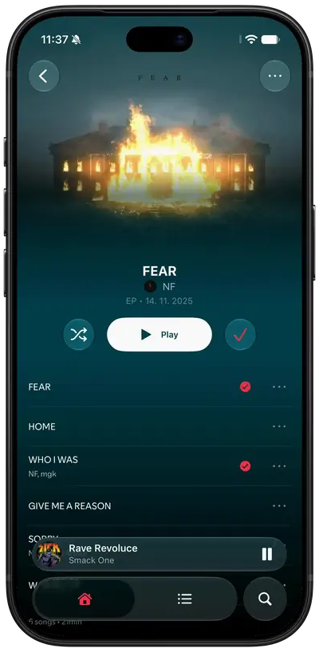
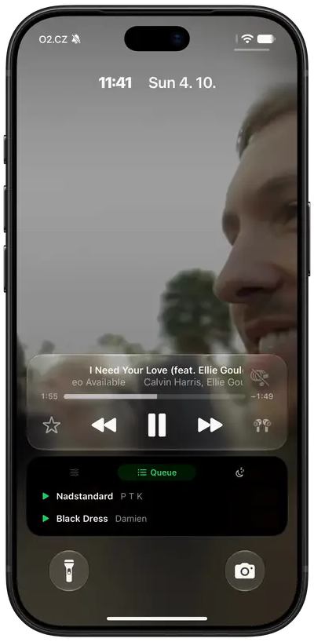

  

<h1 align="center">spoti.pw</h1>

Spotify, in glass.

  
  
  
  
  

  <a href="https://spoti.pw">spoti.pw</a> ·
  <a href="#build-it">Build it</a> ·
  <a href="docs/tweaks.md">Hack on it</a> ·
  <a href="https://ko-fi.com/darkksh">Support</a>

  
  
  
  
  
  

A no-jailbreak Theos tweak that rebuilds Spotify for iOS in Liquid Glass, injected into your own
decrypted IPA and signed with your own certificate.

Built and tested on **Spotify 9.1.78** — use that version's IPA. The mod hooks Spotify's own classes,
which change between releases, so another version may build and then break.

| | |
|---|---|
| The redesign | **iOS 26+** |
| Legacy look | iOS 16.1+ |
| Live Activity | iOS 17+ |

The redesign is `UIGlassEffect`, which only exists from iOS 26. Below that the Redesigned UI switch
is greyed out and the mod runs Spotify's own screens with everything else it adds on top. Both live
in Settings → Mod Settings.

## spoti.duo experimental branch

This fork adds Duo-aware navigation and **Dark, Light, and System (at launch)** appearance to the redesigned UI. Choose the appearance in Mod Settings, then close and reopen Spotify. The native theme bridge was audited against Spotify **9.1.94**, with simulator fixtures and an isolated real-provider probe; a complete signed-in app walkthrough is still pending. [Appearance details and limitations](docs/appearance.md).

The exact `com.kyle.spotipw.duo` bundle hides tab labels except when fully open in portrait, where it follows your saved **Hide labels** setting. Other bundle IDs always follow that setting. Create, custom tabs, hidden tabs and saved order use the existing Navbar editor. `DUO=1` alone does not change the bundle ID; choose an identifier that matches your signing profile. [Duo build notes](docs/iphone-duo.md).

The editable [cyan Liquid Glass icon source](assets/Spotify%20Liquid%20Glass.icon) is included. The standard build still uses its existing PNG icon option; native icon catalog integration is not automated. [Icon notes](docs/native-icon.md).

No decrypted Spotify app, signed IPA, certificate, profile or proprietary test binary is included. The upstream build instructions below retain their original version default; explicitly selecting 9.1.94 requires `EXPECTED_SPOTIFY_VERSION=9.1.94`, a suitable IPA and your own signing setup. This is experimental source for review, not a prebuilt release.

## Build it

No IPA is distributed. Bring a decrypted **Spotify 9.1.78** IPA; you get an unsigned
`spoti.pw-<mod version>.ipa` to sign with SideStore, Feather or any certificate signer. Each
[release](https://github.com/skopevoj/spoti.pw/releases) also carries the tweak's `.deb`.

### Build with GitHub Actions

Fork the repo, enable Actions, run **Build IPA from your own Spotify IPA**. It takes a direct link to
your decrypted `.ipa` and hands the built IPA back as a workflow artifact. No Mac needed; the link is
masked in the log and the result stays in your fork.

### Build on a Mac

Theos in `~/theos` and Xcode with an iPhoneOS 26+ SDK (`xcode-select` it). An SDK in `~/theos/sdks`
alone builds too, but without the Live Activity. Then:

    brew install make ldid dpkg zsign ideviceinstaller libimobiledevice
    uv tool install "cyan @ git+https://github.com/asdfzxcvbn/pyzule-rw"

Put the decrypted `.ipa` in `ipa/`, then:

    make release    # out/spoti.pw-<version>.ipa, ready to sign
    make install    # the same, signed with your certificate and pushed over USB

`make install` reads `SIGN_P12`, `SIGN_PROFILE` and `SIGN_P12_PASSWORD` from `.signing.env`; copy
`.signing.env.example` and fill it in.

The first build, or a change of source IPA, reads Spotify's flags from that IPA. `make flags` regenerates the table.

### iPhone Duo (experimental)

Duo support applies to **Redesigned UI** and requires building with an **iPhoneOS 27.1+
SDK**. The window's native `verticalBarEdge` trait and layout region select the side rail;
other layouts retain the bottom tab bar. Tab order, custom links, Create, Home's hold action,
and the existing **Hide labels** preference are preserved. The exact spoti.duo bundle applies
the posture-specific label policy above.

The miniplayer and Library content clear the rail, the player's real menu control stays
reachable, playlist headers center in the usable column, and open lyrics recover when a
fold or window resize takes away their space. Native UI remains Spotify's responsibility.

[Apple's preparation guide](https://developer.apple.com/iphone-duo/prepare/) explains why
the SDK linked by the **main app**, not an injected tweak, controls Duo compatibility.
For an audited input IPA, this explicit option retargets the main executable's SDK metadata:

    make release DUO=1 IPA=/path/to/Spotify-9.1.78.ipa

`DUO=1` / `--duo` uses the selected installed SDK, preserves the minimum OS, build-tool
metadata and injected load commands, updates matching SDK plist metadata, and signs the
changed executable ad hoc with its existing entitlements before normal certificate signing.
It refuses an SDK downgrade. **This does not recompile Spotify or establish compatibility
with every newer SDK behavior.** Without the option, the main executable is not retargeted.

The input preflight checks the Spotify version and bundle, thin arm64 executable and
decrypted state. The default remains **9.1.78**. A different version requires an explicit
`EXPECTED_SPOTIFY_VERSION` override and its own hook audit; the override does not make it
supported. Flag-table caching is keyed by the IPA, extractor and generated table.

To select a paired device for installation, use `DEVICE_UDID=<device-udid> make install`.
Add `WIFI=1` only for a device already paired for wireless sync.

Run the build regressions with `python3 -m unittest discover -s tests -v`. The actual
Mach-O retarget/sign test needs Xcode and `ldid`. UIKit regression harnesses and their
commands are in [docs/iphone-duo.md](docs/iphone-duo.md). **Keep this experimental until
those harnesses and the injected app are verified against the chosen Spotify version.**

### Signing

Sign with a bundle id matching your certificate's App ID. If it doesn't match, the app still works
but tapping the player on the lock screen won't open it — and it tells you on first launch which id
to use. In Feather, copy the App ID into **Identifier** and leave **PPQ protection** off; AltStore,
SideStore and Sideloadly get this right on their own.

The app keeps Spotify's bundle id, so it installs over the real Spotify.

## Support

If it made your phone nicer to use, a coffee is a good way to say so.

## Contributing

Pull requests are welcome. The pull request's description has a box for agreeing to the
[Contributor License Agreement](CLA.md), which gives the project's owner the rights to the
contribution; it is ticked once, before the first pull request is merged.

## Star history

<a href="https://star-history.com/#skopevoj/spoti.pw&Date">
  <picture>
    <source media="(prefers-color-scheme: dark)" srcset="https://api.star-history.com/svg?repos=skopevoj/spoti.pw&type=Date&theme=dark">
    
  </picture>
</a>

## Credits

[cyan](https://github.com/asdfzxcvbn/pyzule-rw) injects, [Theos](https://theos.dev) builds, and
[FLEX](https://github.com/FLEXTool/FLEX), as hopeless's AutoFLEX build in `vendor/`, is the inspector
the view trees are read through.

## License

Source available under the [PolyForm Strict License 1.0.0](LICENSE): you can read the code and use
the mod yourself, but not change it, reuse it in other projects or redistribute it. Releases up to
v0.21.1 were published under GPL-3.0 and stay under it. Files in `vendor/` and `.agents/` keep their
own licences.

Not affiliated with Spotify.
